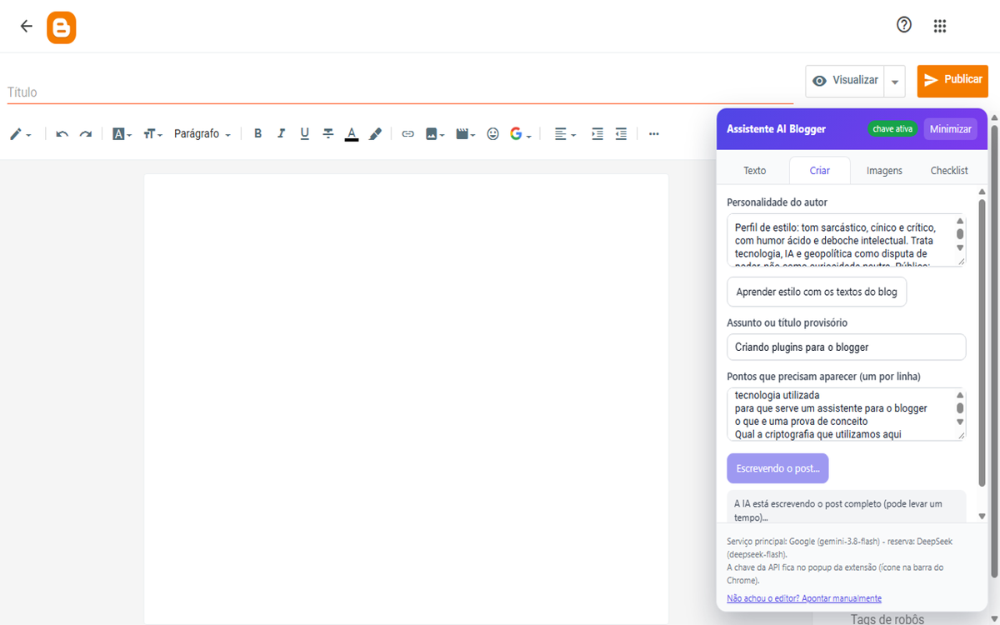
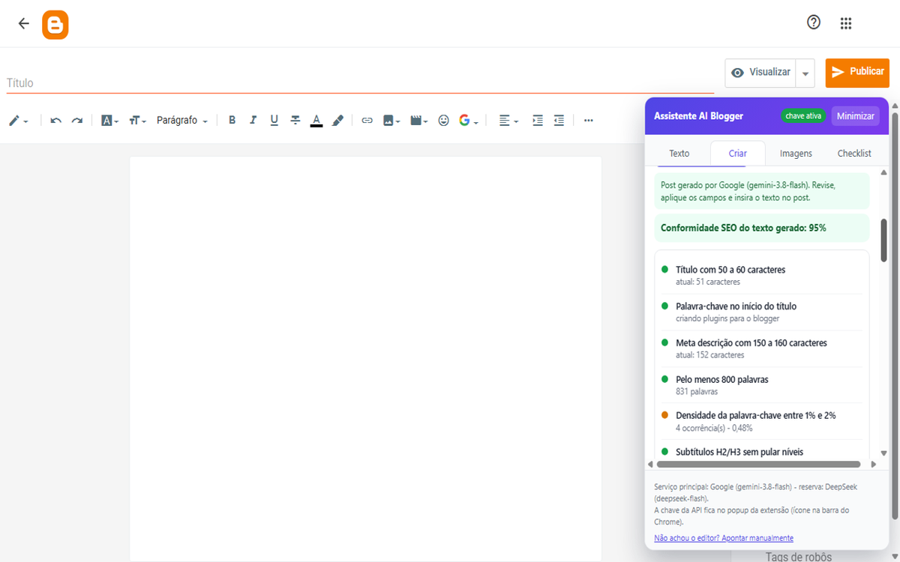
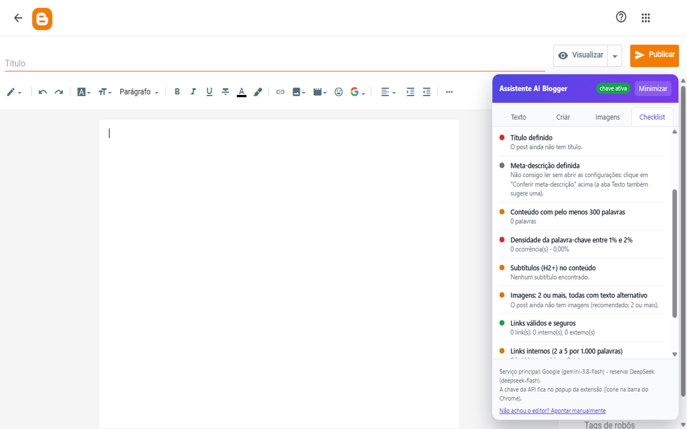
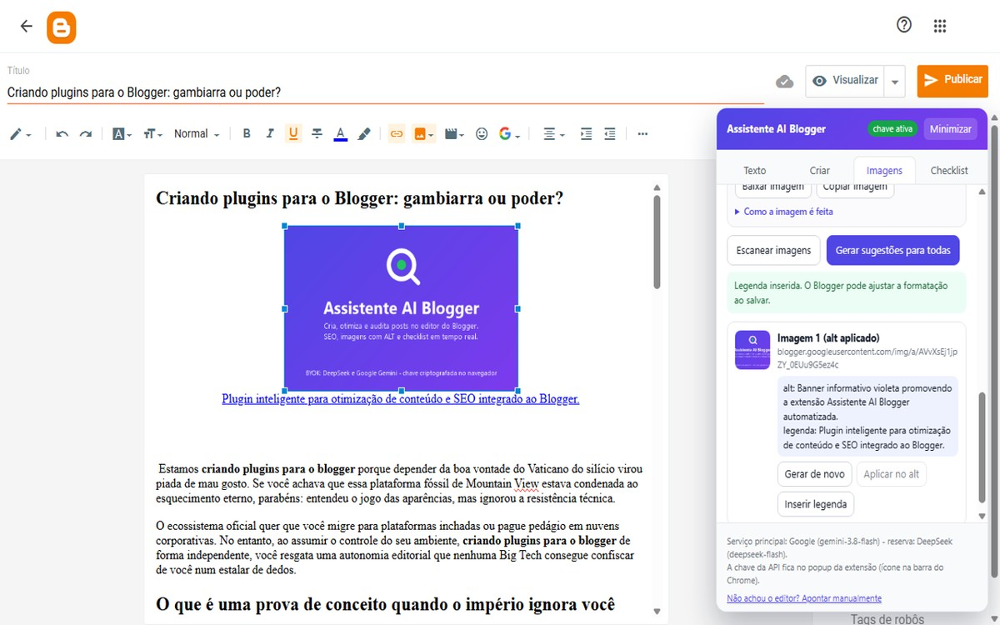
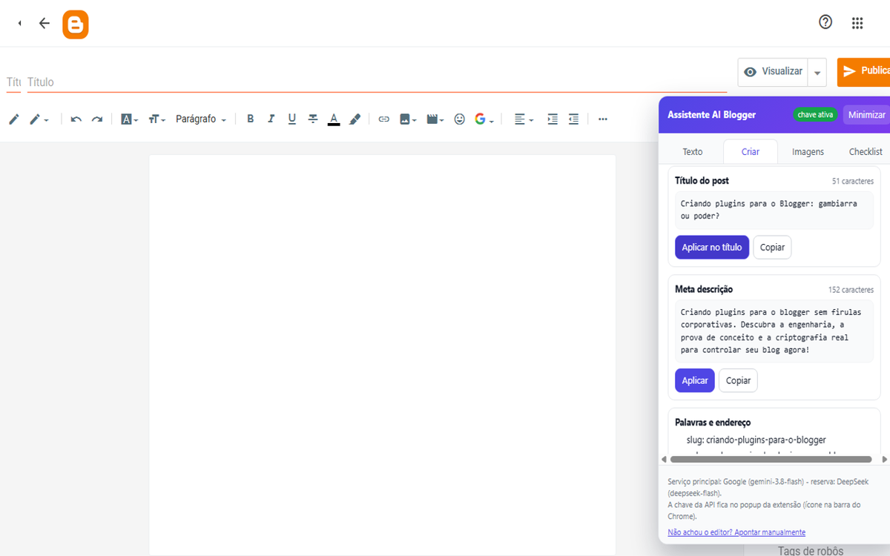

# Instalar pelo GitHub

Este guia instala a versão **1.2.0** da extensão no Google Chrome usando o arquivo publicado neste repositório. A V2.0.0 ainda está em teste local; este pacote é da versão anterior.

## 1. Baixar e extrair

1. Abra [`loja/assistente-ai-blogger-v1.2.0.zip`](../loja/assistente-ai-blogger-v1.2.0.zip) neste repositório GitHub.
2. Na página do arquivo, clique em **Download raw** para baixar o ZIP.
3. No Explorador de Arquivos, clique com o botão direito no arquivo e escolha **Extrair tudo**. Guarde a pasta extraída em um local permanente; não carregue o arquivo ZIP diretamente no Chrome.

## 2. Carregar no Chrome

1. Abra `chrome://extensions`.
2. Ative **Modo do desenvolvedor**.
3. Clique em **Carregar sem compactação** e escolha a pasta extraída que contém `manifest.json`.
4. Se quiser acesso rápido, abra o menu de extensões do Chrome e fixe **Assistente AI Blogger** na barra.

## 3. Abrir o Blogger e configurar suas chaves

1. Abra o editor de um post do Blogger. O painel da extensão aparece nas telas de edição.
2. Abra o popup da extensão, selecione Google Gemini ou DeepSeek e configure sua própria chave de API.
3. A extensão guarda as chaves **criptografadas** no navegador. Não coloque chave, senha ou `.env` no GitHub.

As imagens a seguir são capturas da **versão 1**, consultadas na [listagem da extensão na Chrome Web Store](https://chromewebstore.google.com/detail/assistente-ai-blogger/dknljonehldnnlgdeonapcnnkolopedd). Elas mostram as telas e recursos que o usuário verá depois de instalar; a sequência de instalação está descrita nos passos acima.

*A aba Criar mostra a geração de um rascunho dentro do editor do Blogger.*

*O checklist mostra uma pontuação de conformidade e os critérios avaliados.*

*Com o editor vazio, o painel indica quais itens do post ainda precisam ser preenchidos.*

*Os recursos de imagem ajudam a criar imagens e descrições alternativas.*

*As sugestões podem ser copiadas ou aplicadas ao post após revisão.*

## Segurança

- Baixe o pacote somente deste repositório oficial.
- O arquivo da loja contém apenas os arquivos distribuíveis da extensão; ele não precisa nem deve conter suas chaves.
- A chave é pessoal e pode gerar cobranças no provedor de IA. Configure-a somente no popup local da extensão e nunca em um Issue, comentário, captura ou arquivo enviado ao GitHub.
- Para remover a extensão, abra `chrome://extensions`, localize **Assistente AI Blogger** e escolha **Remover**.
